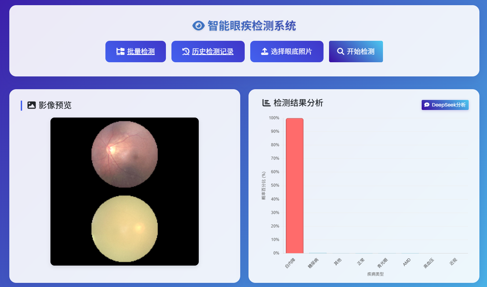
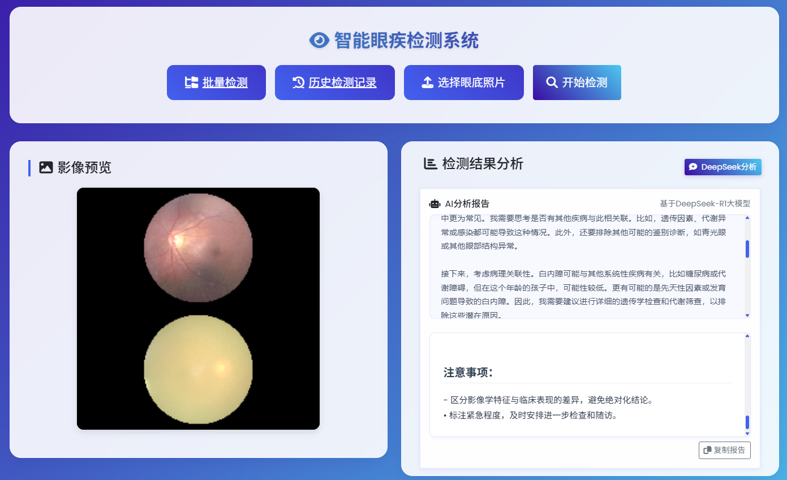
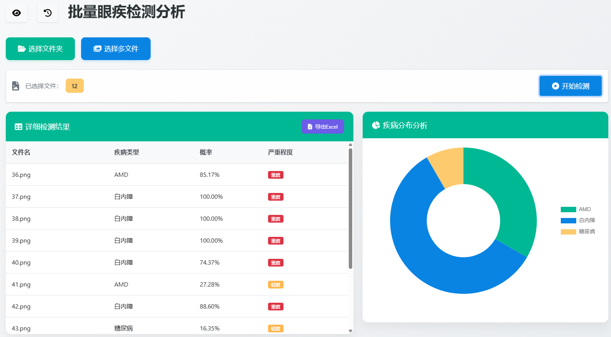
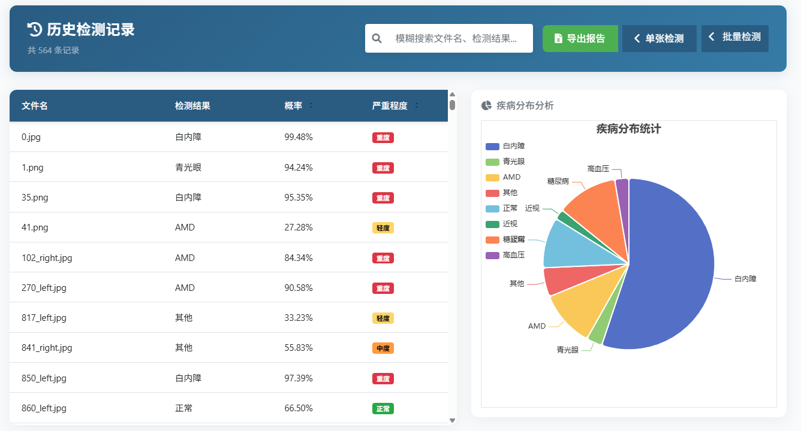

# 视域经纬 · 眼底影像识别与分析系统

基于 **PyTorch、EfficientNet 与 Flask** 的眼底影像识别项目，提供单图检测、批量处理、历史记录和 Excel 导出，并可接入 DeepSeek 生成结果解读。

本仓库用于课程实践、算法学习与系统演示。模型输出属于实验性预测，页面中的“严重程度”来自概率阈值映射，不能作为临床诊断或疾病分期依据。



## 项目特点

- **八类别多标签识别**：输出正常、糖尿病、青光眼、白内障、AMD、高血压、近视、其他八个类别的预测分数，并按分数排序。
- **单图与批量检测**：支持图片预览、类别分布展示、批量结果汇总和明细查看。
- **大模型结果解读**：支持本地 Ollama 与硅基流动 API 两种接入方式；可结合用户补充信息生成流式文本。
- **历史记录与导出**：预测结果保存到本地 JSON，前端提供记录查询、统计展示和 `.xlsx` 导出。
- **CPU / CUDA 推理**：程序自动检测 CUDA，未检测到时使用 CPU。

## 界面预览

以下截图提取自项目原有 Word《项目测试报告》，反映当时的演示界面；截图中的数据为历史示例，不代表本次重新测得的准确率。图片来源见 [图片说明](docs/images/README.md)。

### DeepSeek 结果解读



### 批量检测



### 历史记录



## 工作流程

上传眼底图片后，服务端将图片转换为 RGB、缩放至 `380 × 380`，并使用 ImageNet 均值与标准差归一化。默认模型为 **EfficientNet-B4 + CBAM 注意力模块 + 自定义分类头**。

模型输出通过逐类别 `sigmoid` 得到八个分数。因此，各类别分数相互独立，总和不要求等于 100%。预测结果写入 `predictions.json`，供历史记录页面读取；DeepSeek 解读作为独立步骤按需调用。

## 快速开始

### 1. 获取代码与模型

```bash
git clone https://github.com/YiYun-ll/EyeDiseaseDetection.git
cd EyeDiseaseDetection
git lfs install
git lfs pull
```

`best_model.pth` 通过 Git LFS 管理，需要安装 Git LFS。完整文件大小为 **305,396,526 字节（约 291 MiB）**；如果文件只有一百多字节，取得的是 LFS 指针，需要重新拉取实际权重。

程序从仓库根目录读取 `best_model.pth`，并加载其中的 `model_state_dict`。默认配置使用 EfficientNet-B4，权重结构必须与 `configs/default.yaml` 中的模型配置一致。

### 2. 安装依赖

建议为本项目单独创建虚拟环境。本次推理验证使用 **Python 3.9.13、PyTorch 2.3.1、torchvision 0.18.1、Flask 3.1.3**。

```bash
python -m venv .venv
```

Windows PowerShell 激活：

```powershell
.\.venv\Scripts\Activate.ps1
```

Linux / macOS 激活：

```bash
source .venv/bin/activate
```

安装推理与 Web 服务依赖：

```bash
python -m pip install torch==2.3.1 torchvision==0.18.1
python -m pip install Flask==3.1.3 "numpy<2" Pillow PyYAML requests "urllib3>=2,<3" ollama
```

使用 CUDA 时，应安装与本机驱动匹配的 PyTorch 构建。上述环境验证使用 CPU，未验证 CUDA 推理。

### 3. 启动识别服务

在仓库根目录执行：

```bash
python app.py
```

打开 [本机首页](http://127.0.0.1:5000)，点击“进入检测系统”。也可直接访问：

- [单图检测](http://127.0.0.1:5000/system)
- [批量检测](http://127.0.0.1:5000/batch)
- [历史记录](http://127.0.0.1:5000/history)

图片识别与历史记录不依赖大模型服务；点击 DeepSeek 分析入口时才会调用对应服务。

## 大模型接入

### 本地 Ollama

`app.py` 使用的模型名为 `deepseek-r1:14b`。使用此功能前，安装并启动 Ollama，再准备对应模型：

```bash
ollama pull deepseek-r1:14b
python app.py
```

14B 模型所需资源与运行速度取决于量化版本及本机硬件；本次未运行大模型解读验证。

### 硅基流动 API

`app_api.py` 调用硅基流动的聊天补全接口，代码中的模型名为 `deepseek-ai/DeepSeek-R1`。运行前，在该文件的请求头中配置自己的有效凭据，再执行：

```bash
python app_api.py
```

两个入口默认都使用 `5000` 端口，选择一个启动。当前代码没有读取 API Key 的环境变量；如需从环境变量获取凭据，应先调整请求头的读取方式，避免将实际密钥提交到仓库。

## 主要配置

`configs/default.yaml` 控制模型与输入尺寸：

```yaml
model:
  name: "efficientnet-b4"
  num_classes: 8
  pretrained: true
  dropout_rate: 0.5

data:
  img_size: 380
```

当 `pretrained: true` 时，torchvision 可能先下载 ImageNet 初始化权重。如果已经取得完整的 `best_model.pth`，可将该项改为 `false`，避免额外下载；随后仍会加载项目的完整模型参数。

上传请求上限为 **16 MiB**，批量处理上限为 **150 张**，对应两个入口中的 `MAX_CONTENT_LENGTH` 与 `BATCH_LIMIT`。批量请求还受总请求体大小限制。

## 仓库结构

```text
EyeDiseaseDetection/
├── app.py                     # Flask 服务与本地 Ollama 接入
├── app_api.py                 # Flask 服务与硅基流动 API 接入
├── best_model.pth             # Git LFS 模型权重
├── configs/                   # 模型、数据与路径配置
├── models/efficientnet.py      # 主干网络、CBAM 与分类头
├── scripts/preprocess_data.py # 数据预处理辅助脚本
├── utils/                     # 数据加载、增强、指标与日志工具
├── web/
│   ├── templates/             # 首页、单图、批量与历史页面
│   └── static/                # CSS、JavaScript 与界面资源
└── docs/images/               # README 使用的原始项目截图
```

运行时还会创建 `static/uploads/` 和 `predictions.json`。

## 运行验证与当前边界

2026 年 10 月 27 日，使用与 Git LFS 指针 SHA-256 一致的本机权重，在 Windows CPU 环境中对 `app.py`、`app_api.py` 分别完成验证：

- 四个页面路由均返回 HTTP 200。
- 使用仓库内已有样例图片完成单图推理，返回八个类别分数。
- 两张图片的批量推理成功，历史 JSON 可读取。
- 缺少上传图片时返回 HTTP 400。

上述检查通过 Flask 测试客户端完成，验证服务路由与实际模型推理；未覆盖浏览器交互、Excel 文件导出、外部 CDN 加载或大模型服务。可查看 [验证记录](docs/verification.json)。

公开仓库目前提供模型推理和 Web 展示相关代码，**未包含 `train.py`、完整训练数据集和独立评测入口**，因此不能直接据此复现完整训练或确认模型泛化指标。`scripts/`、`utils/` 中的训练相关工具需自行准备数据并补齐训练流程。

还需注意以下实现限制：

- “轻度 / 中度 / 重度”是代码中的分数阈值映射，两个服务入口的中度阈值也存在差异，不应解读为经过临床验证的严重程度分级。
- 上传保存路径为 `static/uploads/`，Flask 默认静态资源目录为 `web/static/`；部分历史图片 URL 可能无法访问，部署前需统一这两处路径。
- 页面样式、图表和 Excel 导出依赖外部 CDN；受限网络下可能出现资源加载问题。
- 历史记录使用本地 JSON 文件，未提供用户隔离、身份认证及并发数据库存储，适合本地演示。

## 交流与授权

欢迎通过 [Issues](https://github.com/YiYun-ll/EyeDiseaseDetection/issues) 反馈复现问题；请附上 Python / PyTorch 版本、启动方式与脱敏后的错误日志。

仓库当前未提供 `LICENSE` 文件。代码、权重及示例素材的使用与再分发范围，请先与仓库维护者确认；数据集还需遵守其原始来源的授权要求。
